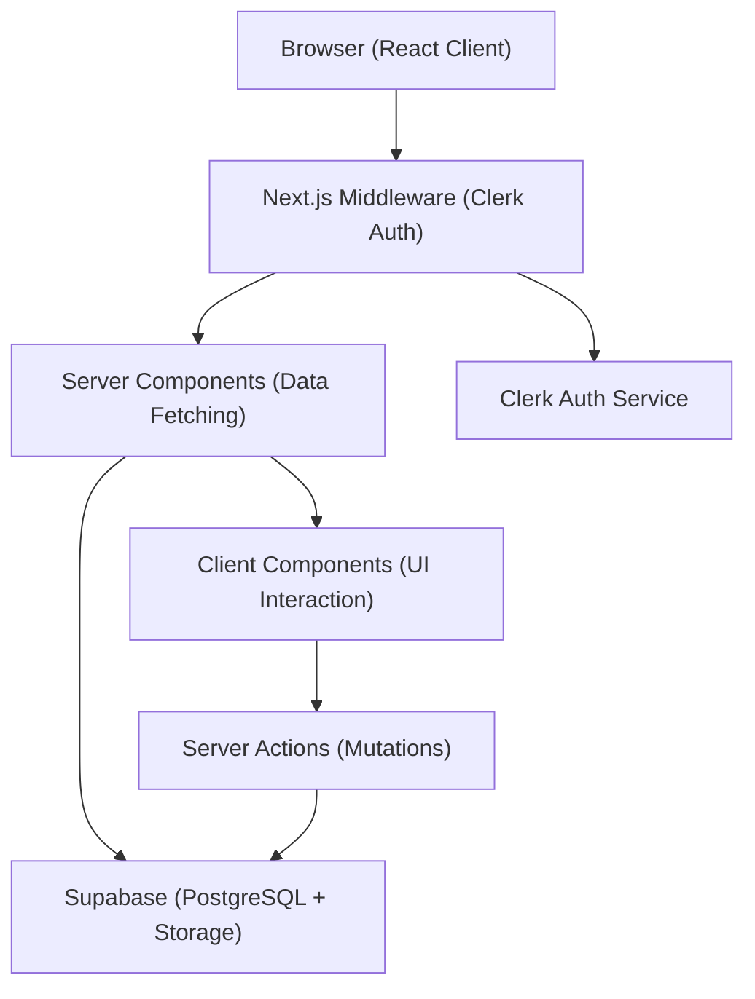

# Stock Sewa — Technical Documentation
> **Version:** 1.0 · **Stack:** Next.js 16 · Supabase · Clerk · Vercel · TypeScript

This document is a comprehensive technical reference for the **Stock Sewa** application. It covers architecture, database design, core business logic, authentication, deployment, and feature details. It is intended for a developer or new owner taking ownership of the codebase.

---

## 1. Project Overview

**Stock Sewa** is a multi-tenant SaaS inventory and Point-of-Sale (POS) application designed specifically for small shopkeepers in Nepal. Each shop owner registers independently and gets their own isolated data environment.

### Key Capabilities
| Feature | Description |
|---|---|
| **Product Management** | Add, update, delete, and restock products with barcodes |
| **Point of Sale (POS)** | Cart-based checkout with per-item discounts |
| **Invoice Generator** | Supports Normal / PAN / VAT bill types with PDF print |
| **Customer CRM** | Customer records with PAN/VAT numbers |
| **Reports** | Daily, weekly, monthly revenue and stock insights |
| **Settings** | Logo upload, shop details, PAN/VAT configuration |
| **Nepali Date Support** | All dates shown in Bikram Sambat (B.S.) via `date-utils.ts` |

---

## 2. Technology Stack

| Layer | Technology | Purpose |
|---|---|---|
| Frontend & Backend | **Next.js 16** (App Router, Turbopack) | Full-stack React framework |
| Language | **TypeScript** | Type safety across the entire codebase |
| Database | **Supabase (PostgreSQL)** | Relational DB, Row-Level Security, Storage |
| Authentication | **Clerk** | User signup, login, session management |
| Deployment | **Vercel** | CI/CD, serverless functions, CDN |
| Styling | **Vanilla CSS** (`app/globals.css`) | Custom design system with CSS variables |
| Icons | **lucide-react** | Consistent icon library |
| Notifications | **sonner** | Toast notifications |
| PDF / Barcode | **jsPDF + JsBarcode** | Invoice PDF generation and barcode label printing |
| Date (BS) | Custom `date-utils.ts` | Bikram Sambat calendar conversion |

---

## 3. System Architecture



### Request Lifecycle
1. **Browser** makes a request to any `/dashboard/*` route
2. **Clerk Middleware** (`middleware.ts`) intercepts — if no valid session, redirects to `/login`
3. **Server Component** calls `getOrgContext()` which reads the Clerk `userId`, looks up that user's `organization_id` from the Supabase `profiles` table
4. **Server Component** fetches data from Supabase using the `organizationId` for strict tenant isolation
5. **Page renders** with data pre-loaded. Interactive parts are marked `'use client'` and hydrated in the browser
6. **User interactions** (add product, create invoice) call **Server Actions** (`'use server'`) which mutate data in Supabase and call `revalidatePath()` to refresh the UI

---

## 4. Multi-Tenancy Architecture

This is the **most critical architectural concept** in Stock Sewa. Every piece of data is scoped to an organization.

### How it works

```
Clerk User (userId) → profiles.id → profiles.organization_id → All data tables (organization_id)
```

- **Clerk** handles authentication. Each user has a unique `userId`.
- The Supabase `profiles` table links a Clerk `userId` to an `organization_id`.
- Every data table (`products`, `customers`, `invoices`, etc.) has an `organization_id` column.
- The `getOrgContext()` function in `src/lib/org-context.ts` is the **gatekeeper** — it must be called at the start of every server action and server-component data fetch. It returns the `organizationId` and `organizationName`.
- All Supabase queries **must** filter by `.eq('organization_id', organizationId)` — this is the application-level guarantee of data isolation.
- **Row-Level Security (RLS)** provides a second layer of database-level isolation (see schema section).

> [!CAUTION]
> Never make a Supabase query in a server action without first calling `getOrgContext()` and filtering by `organizationId`. Failing to do so would allow data leakage between tenants.

---

## 5. Authentication Flow

Authentication is handled entirely by **Clerk**.

```
/login → Clerk Sign-In → Redirect to /dashboard
/signup → Clerk Sign-Up → DB Trigger (auto-creates org + profile) → /setup
```

### Signup Process (Automatic Onboarding)
When a new user signs up via Clerk, a **Supabase database trigger** (`handle_new_user`) fires automatically:
1. Reads `org_name` from Clerk user metadata
2. Creates a new row in the `organizations` table
3. Creates a new row in the `profiles` table linking the Clerk userId to the new organization

This means every user is **self-sufficient** — no manual setup is needed by the admin.

### Middleware (`src/middleware.ts`)
```typescript
// Public routes (no auth required)
const isPublicRoute = createRouteMatcher(['/login(.*)', '/signup(.*)', '/'])

// All other routes are protected automatically
clerkMiddleware(async (auth, request) => {
    if (!isPublicRoute(request)) {
        await auth.protect(); // Redirects to /login if not authenticated
    }
});
```

---

## 6. Database Schema

The schema file is located at [`schema.sql`](./schema.sql) and must be run in Supabase SQL Editor in the order shown.

### Tables

#### `organizations` — Tenants / Shops
| Column | Type | Description |
|---|---|---|
| `id` | UUID (PK) | Auto-generated unique identifier |
| `name` | TEXT | Shop name |
| `pan_vat` | TEXT | PAN or VAT registration number |
| `address` | TEXT | Physical address |
| `phone` | TEXT | Contact number |
| `logo_url` | TEXT | URL to logo stored in Supabase Storage (`logos` bucket) |
| `created_at` | TIMESTAMPTZ | Creation timestamp |

#### `profiles` — User → Organization Link
| Column | Type | Description |
|---|---|---|
| `id` | UUID (PK, FK → auth.users) | Clerk userId mapped here |
| `organization_id` | UUID (FK → organizations) | The tenant this user belongs to |
| `username` | TEXT (UNIQUE) | Optional display username |
| `created_at` | TIMESTAMPTZ | Creation timestamp |

> [!NOTE]
> With Clerk integration, `profiles.id` stores the **Clerk userId string**, not a Supabase auth UUID.

#### `products` — Inventory Items
| Column | Type | Description |
|---|---|---|
| `id` | UUID (PK) | Unique product ID |
| `organization_id` | UUID (FK) | Tenant isolation |
| `name` | TEXT | Product name |
| `barcode` | TEXT | Auto-generated 11-digit barcode if not supplied |
| `price` | DECIMAL(12,2) | Selling price (MRP) |
| `cost_price` | DECIMAL(12,2) | Purchase/cost price (for margin calc) |
| `stock_quantity` | INTEGER | Current stock level |
| `unit` | TEXT | Unit of measure (`pcs`, `kg`, `ltr`, etc.) |
| `category` | TEXT | Product category |
| `mfg_date` | TEXT | Manufacturing date (optional) |
| `expiry_date` | TEXT | Expiry date (optional) |
| `batch_number` | TEXT | Batch reference (optional) |
| `created_at` | TIMESTAMPTZ | Creation timestamp |

#### `customers`
| Column | Type | Description |
|---|---|---|
| `id` | UUID (PK) | Unique customer ID |
| `organization_id` | UUID (FK) | Tenant isolation |
| `name` | TEXT | Full name |
| `phone` | TEXT | Contact number |
| `email` | TEXT | Email address |
| `pan_number` | TEXT | PAN/VAT number (for tax invoices) |
| `address` | TEXT | Address |
| `created_at` | TIMESTAMPTZ | Creation timestamp |

#### `invoices`
| Column | Type | Description |
|---|---|---|
| `id` | UUID (PK) | Unique invoice ID |
| `organization_id` | UUID (FK) | Tenant isolation |
| `customer_id` | UUID (FK, nullable) | Linked customer (null for walk-in) |
| `invoice_number` | TEXT | Human-readable, e.g. `INV-2081-0042` |
| `invoice_type` | TEXT | `'normal'`, `'pan'`, or `'vat'` |
| `subtotal` | DECIMAL | Net subtotal (after discounts, before tax) |
| `discount_amount` | DECIMAL | Total discount applied |
| `tax_amount` | DECIMAL | VAT amount (13% if type=`vat`, else 0) |
| `total_amount` | DECIMAL | Final amount payable |
| `payment_method` | TEXT | `'cash'`, `'esewa'`, `'bank_transfer'`, etc. |
| `payment_status` | TEXT | `'paid'`, `'unpaid'`, `'partial'` |
| `amount_paid` | DECIMAL | Amount actually received |
| `notes` | TEXT | Optional notes |
| `date_ad` | DATE | Invoice date (AD) |
| `date_bs` | TEXT | Invoice date in Bikram Sambat |
| `created_at` | TIMESTAMPTZ | Creation timestamp |

#### `invoice_items` — Line Items (Snapshot)
| Column | Type | Description |
|---|---|---|
| `id` | UUID (PK) | Unique item ID |
| `invoice_id` | UUID (FK) | Parent invoice |
| `product_id` | UUID (FK, nullable) | Reference to product (nullable if product deleted) |
| `product_name` | TEXT | **Snapshot** of product name at time of sale |
| `quantity` | INTEGER | Quantity sold |
| `unit_price` | DECIMAL | **Snapshot** of price at time of sale |

> [!IMPORTANT]
> `product_name` and `unit_price` are snapshotted on each invoice item. This means historical invoices remain accurate even if the product name or price changes later.

#### `stock_movements` — Immutable Audit Log
| Column | Type | Description |
|---|---|---|
| `id` | UUID (PK) | Unique movement ID |
| `organization_id` | UUID (FK) | Tenant isolation |
| `product_id` | UUID (FK, nullable) | The product |
| `movement_type` | TEXT | `'in'`, `'out'`, or `'adjustment'` |
| `quantity` | INTEGER | Change in stock (negative for `'out'`) |
| `reference_id` | UUID | Related invoice ID for `'out'` movements |
| `notes` | TEXT | Human-readable reason |
| `created_at` | TIMESTAMPTZ | Movement timestamp |

### Row-Level Security (RLS) Policies

All tables have RLS enabled. The core helper function is:

```sql
-- Gets the organization_id of the currently authenticated user
CREATE OR REPLACE FUNCTION public.current_org_id()
RETURNS UUID AS $$
    SELECT organization_id FROM public.profiles WHERE id = auth.uid();
$$ LANGUAGE sql SECURITY DEFINER STABLE;
```

Each table has a policy like:
```sql
CREATE POLICY "products_isolation" ON products
    FOR ALL USING (organization_id = public.current_org_id());
```

> [!NOTE]
> Since the app uses `createAdminClient()` (service role key) for all server-side operations, RLS is bypassed at the application layer and enforced instead at the application code level. The RLS policies serve as a database-level safety net.

### Database Trigger (Auto Onboarding)
```sql
-- Fires after a new user is created in Clerk/auth.users
CREATE TRIGGER on_auth_user_created
    AFTER INSERT ON auth.users
    FOR EACH ROW EXECUTE PROCEDURE public.handle_new_user();
```

The `handle_new_user()` function:
1. Reads `org_name` from `raw_user_meta_data`
2. Inserts into `organizations`
3. Inserts into `profiles` linking user → organization

### Supabase RPC Functions Required
The following must be created in the Supabase SQL Editor:
```sql
-- Atomically decrements stock to prevent race conditions
CREATE OR REPLACE FUNCTION public.decrement_stock(p_product_id UUID, p_quantity INT)
RETURNS void AS $$
    UPDATE products
    SET stock_quantity = stock_quantity - p_quantity
    WHERE id = p_product_id;
$$ LANGUAGE sql SECURITY DEFINER;
```

---

## 7. Invoice Calculation Engine

Located in `src/lib/actions/invoices.ts`.

```typescript
// Step 1: Raw subtotal (sum of all items at full price)
rawSubtotal = items.reduce((sum, item) => sum + item.unit_price * item.quantity, 0)

// Step 2: Apply discount
subtotal = Math.max(0, rawSubtotal - discount_amount)

// Step 3: Apply VAT (only for invoice_type === 'vat')
taxRate = invoice_type === 'vat' ? 0.13 : 0
tax_amount = subtotal * taxRate

// Step 4: Final total
total_amount = subtotal + tax_amount
```

### Invoice Numbering
`INV-{BS_YEAR}-{SEQUENCE}` where sequence is zero-padded to 4 digits (e.g. `INV-2081-0042`).

### Stock Deduction on Checkout
For each line item in a sale:
1. Calls `supabase.rpc('decrement_stock', {...})` to atomically reduce `products.stock_quantity`
2. Inserts a `stock_movements` record of type `'out'` with the invoice as `reference_id`

---

## 8. Barcode & Label System

- Barcodes are **auto-generated** on product creation if not provided.
- Format: `{last-8-digits-of-timestamp}{3-random-digits}` (11 digits total)
- Barcode labels are rendered using `JsBarcode` in the `BarcodeLabel.tsx` component
- Labels show: Product Name, MRP, Barcode, and optionally MFG date
- Labels are printed via the browser's print dialog (`window.print()`)

---

## 9. Nepali Date (Bikram Sambat) Support

Located in `src/utils/date-utils.ts`.

- Converts JavaScript `Date` objects to Bikram Sambat (B.S.) year/month/day
- Used throughout the application for invoice dates and dashboard display
- Returns both formatted English (`formattedEn`) and Nepali (`formattedNp`) date strings
- All invoices store `date_bs` alongside `date_ad` (AD date)

---

## 10. File & Folder Structure

```
src/
├── app/
│   ├── dashboard/
│   │   ├── page.tsx               # Main dashboard (server component)
│   │   ├── products/              # Product management
│   │   ├── pos/                   # Point of Sale checkout
│   │   ├── invoices/              # Invoice history and reprint
│   │   ├── customers/             # Customer CRM
│   │   ├── reports/               # Revenue & stock reports
│   │   └── settings/              # Shop settings & logo upload
│   ├── login/                     # Clerk sign-in page
│   ├── signup/                    # Clerk sign-up page
│   ├── setup/                     # Post-signup onboarding
│   ├── globals.css                # Entire CSS design system
│   └── layout.tsx                 # Root layout with ClerkProvider
├── components/
│   ├── Sidebar.tsx                # Server component sidebar shell
│   ├── SidebarNav.tsx             # Client component with active route highlight
│   ├── LiveClock.tsx              # Client component: live 12-hr clock
│   ├── ClockWrapper.tsx           # Client wrapper for SSR-safe clock loading
│   ├── BarcodeLabel.tsx           # Printable barcode label component
│   └── ThemeProvider.tsx          # Dark/light mode context
├── lib/
│   ├── org-context.ts             # Multi-tenancy gatekeeper (getOrgContext)
│   ├── supabase/
│   │   └── server.ts              # Supabase admin client for server-side use
│   ├── actions/
│   │   ├── products.ts            # Product CRUD + restock server actions
│   │   ├── invoices.ts            # Invoice creation + retrieval server actions
│   │   ├── customers.ts           # Customer CRUD server actions
│   │   ├── organizations.ts       # Settings / logo upload server actions
│   │   └── user.ts                # User profile server actions
│   └── utils/
│       └── invoiceGenerator.ts    # jsPDF-based invoice PDF renderer
├── middleware.ts                  # Clerk auth middleware (route protection)
└── utils/
    └── date-utils.ts              # Bikram Sambat (BS) date converter
```

---

## 11. Environment Variables

Create a `.env.local` file in the project root with these values:

```env
# Supabase
NEXT_PUBLIC_SUPABASE_URL=https://your-project.supabase.co
NEXT_PUBLIC_SUPABASE_ANON_KEY=your-anon-key
SUPABASE_SERVICE_ROLE_KEY=your-service-role-key

# Clerk
NEXT_PUBLIC_CLERK_PUBLISHABLE_KEY=pk_live_...
CLERK_SECRET_KEY=sk_live_...
NEXT_PUBLIC_CLERK_SIGN_IN_URL=/login
NEXT_PUBLIC_CLERK_SIGN_UP_URL=/signup
NEXT_PUBLIC_CLERK_AFTER_SIGN_IN_URL=/dashboard
NEXT_PUBLIC_CLERK_AFTER_SIGN_UP_URL=/dashboard
```

> [!WARNING]
> `SUPABASE_SERVICE_ROLE_KEY` is a **high-privilege key** that bypasses RLS. It must only ever be used server-side and must never be exposed to the browser (`NEXT_PUBLIC_`). Keep it secret.

---

## 12. Deployment (Vercel)

### First-Time Setup
1. Push the repository to GitHub
2. Import the repo in [vercel.com/new](https://vercel.com/new)
3. Set all environment variables from Section 11 in the Vercel dashboard
4. Deploy — Vercel auto-detects Next.js

### Supabase Setup (One-Time)
1. Create a new Supabase project
2. Run `schema.sql` in the Supabase SQL Editor
3. Create the `decrement_stock` RPC function (see Section 6)
4. Create a Storage bucket named `logos` with **public** read access
5. Configure Clerk webhooks if using Clerk-native auth user sync

### CI/CD
Every `git push` to the `main` branch automatically triggers a new Vercel deployment. Preview deployments are created for pull requests.

---

## 13. Key Design Decisions

| Decision | Why |
|---|---|
| **Server Actions for mutations** | Avoids a separate API layer; mutations live close to the UI code |
| **`createAdminClient()` (service role)** | Bypasses Supabase RLS for reliable server-side operations; RLS is the safety net |
| **Snapshotting invoice items** | Preserves historical invoice accuracy when products change |
| **Multi-tenant via `organization_id`** | Simple, performant, single-database multi-tenancy without complex schemas |
| **Clerk for auth** | Handles email verification, sessions, and social auth; reduces auth complexity |
| **Client components only for interactivity** | Server components used for all data-fetching pages; client components only where browser APIs are needed (clock, navigation active state, forms) |
| **`ClockWrapper` pattern** | `next/dynamic` with `ssr: false` cannot be used in Server Components; a Client Component wrapper is required |

---

## 14. Known Limitations / Future Enhancements

- `cost_price` is stored in the database but the UI no longer shows it in the Add Product form (may be cleaned up in a future migration)
- Reports page shows aggregate data but does not export to Excel/CSV yet
- Stock `adjustment` movements are logged but no UI exists to create manual adjustments
- No role-based access control (RBAC) — all users of the same organization have full access
- No mobile-responsive layout optimization (designed for desktop/tablet)
